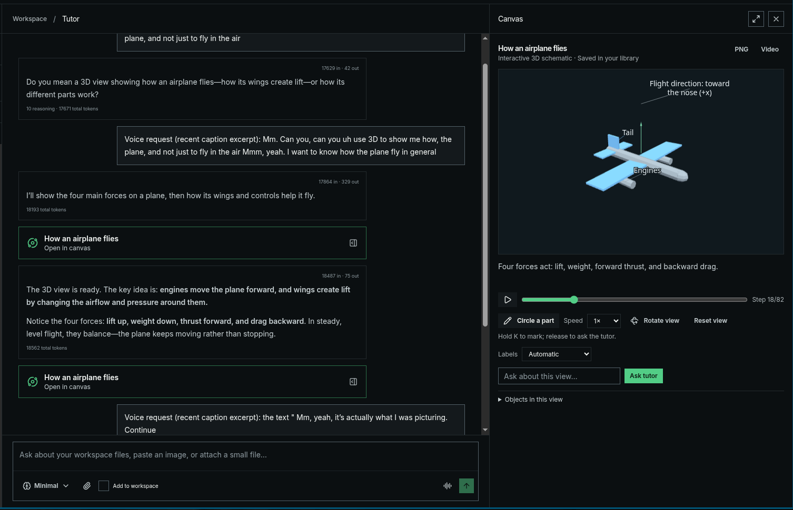

# Kurio

Your friendly AI tutor for homeschool and self-study, with study plans, quizzes,
flashcards, and interactive visuals.

Use this repository's GitHub Issues to report bugs or suggest features. Please
include steps to reproduce a bug and avoid sharing personal information or private
learning material.

## Getting Started

Visit [kuriohop.com](https://kuriohop.com/) to learn about Kurio, or
[open the app](https://app.kuriohop.com/) to start learning.

## Features

Explore Kurio's learning tools on [our website](https://kuriohop.com/#explore).

## Resources

- Website: https://kuriohop.com/
- App: https://app.kuriohop.com/
- Pricing: https://kuriohop.com/pricing/
- Support: [help@support.kuriohop.com](mailto:help@support.kuriohop.com)

## Security

Please do not report security vulnerabilities through public issues. See
[SECURITY.md](SECURITY.md) and email [help@support.kuriohop.com](mailto:help@support.kuriohop.com).
